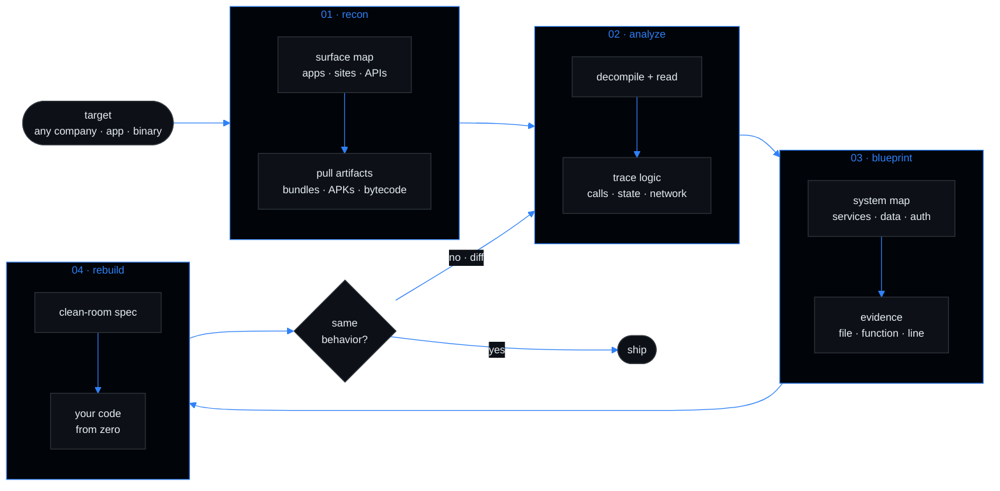

<p align="center">
  
</p>

<p align="center">
  <b>Point it at any product. Get back the blueprint.</b>
</p>

<p align="center">
  
  
  
</p>

<br>

Pick a company. REA takes apart everything it ships — desktop app, web app, mobile app, APIs, smart contracts — and hands you the blueprint: every system, every data flow, every decision, with evidence down to the file and function.

Then you rebuild it. From zero.

<br>

```
$ rea analyze --target "any company"

  surfaces    web · desktop · android · api · contracts
  traced      every call, every request, every state change
  mapped      auth · billing · sync · search · storage · ...
  output      blueprint.md  — how it works, with evidence

$ rea rebuild --from blueprint.md
```

<br>

## How it works



<br>

## Targets

| Target | What REA reads |
|---|---|
| Desktop apps | Electron, `.exe`, macOS apps — Notion, Slack, Discord |
| Websites | page structure, scripts, network requests |
| Games | native binaries, Unity, legacy titles |
| Android | decompiled APKs, permissions, logic |
| Smart contracts | EVM bytecode, functions, risks |
| Everything else | .NET, firmware, WASM, Go binaries |

<br>

## Why

Understand how anything works. Get exact files, functions and logic — not guesses. Learn, audit, and build your own version.

<br>

---

<p align="center">
  <sub>MIT · for research, education, security and interoperability · respect licenses and local law</sub>
</p>
